  

  
  
  

 

<table>
  <tr>
    <td width="62%" valign="top">
      <h2>Hi, I'm Annie 👋</h2>
      

        I turn <b>research questions</b> into evidence, and ideas into products people can actually use.  
        My work lives where <b>finance, AI, data, and human-centered design</b> meet. I care about rigorous thinking, elegant experiences, and technology that gives more people a seat at the table.
      

      

        <code>Researcher</code> · <code>Builder</code> · <code>Storyteller</code>
      

    </td>
    <td width="38%" valign="top">
      <h3>Right now</h3>
      
📈 Exploring data-driven finance

      
🤖 Building AI-native experiences

      
🫶 Designing for accessibility

      
✨ Turning serious ideas into delightful products

    </td>
  </tr>
</table>

## Selected creations

<table>
  <tr>
    <td width="50%" valign="top">
      <h3>TOUCH · 触美</h3>
      
A multimodal beauty assistant designed for people with visual, color-perception, or fine-motor differences.

      
<code>AI</code> <code>Accessibility</code> <code>Product Design</code>

    </td>
    <td width="50%" valign="top">
      <h3>Snowbound Manor · 雪夜庄园</h3>
      
An atmospheric interactive mystery where every clue, conversation, and choice moves the story forward.

      
<code>Interactive Story</code> <code>Web</code> <code>Creative Tech</code>

    </td>
  </tr>
  <tr>
    <td width="50%" valign="top">
      <h3>Finance × Evidence</h3>
      
Empirical research workflows that connect financial questions with careful modeling and clear narratives.

      
<code>Stata</code> <code>Python</code> <code>Econometrics</code>

    </td>
    <td width="50%" valign="top">
      <h3>What's next?</h3>
      
Something useful, thoughtful, and a little unexpected. Follow along — the best work is still being built.

      
<code>Always Learning</code> <code>In Progress</code>

    </td>
  </tr>
</table>

## My creative toolkit

## GitHub pulse

  <picture>
    <source media="(prefers-color-scheme: dark)" srcset="https://raw.githubusercontent.com/Annie-ZRM/Annie-ZRM/output/github-contribution-grid-snake-dark.svg" />
    
  </picture>

---

  <h3>Ideas become interesting when they become real.</h3>
  
如果你也在做值得认真对待的事，欢迎来找我聊聊。

  

<!--
  Hello, curious human 👀
  Thanks for reading the source. The details matter here.
-->
