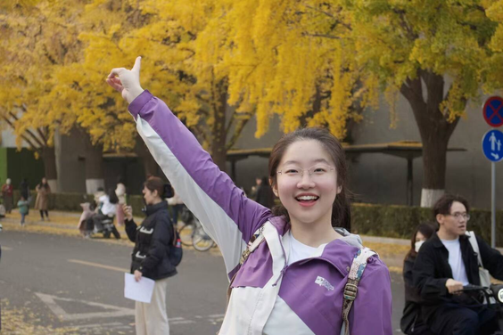
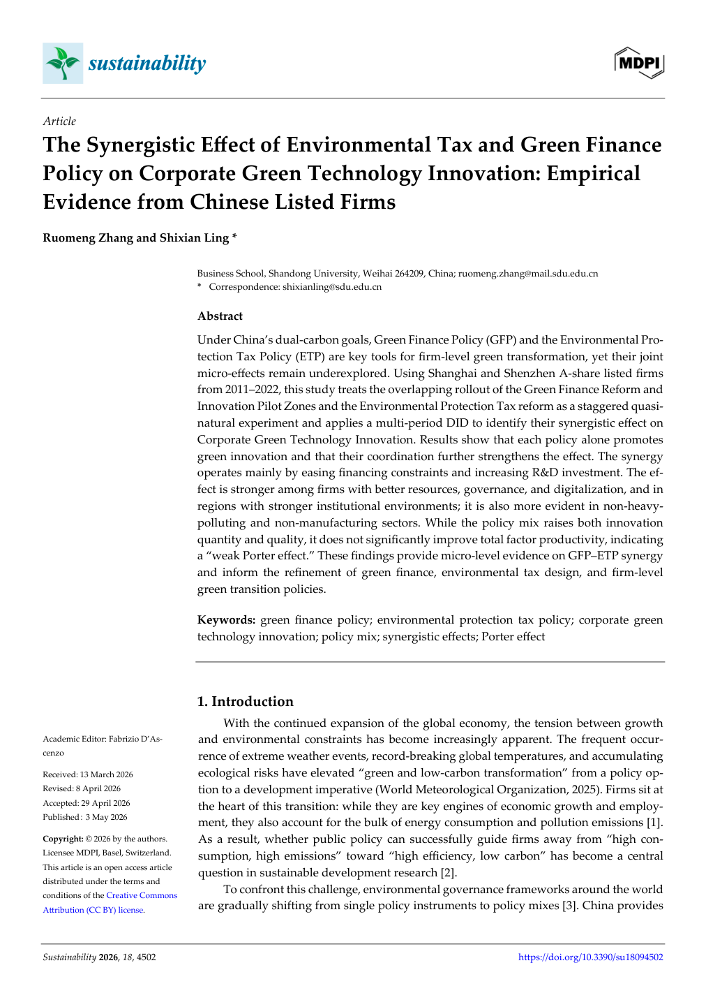

  

  
  
  

 

<table>
  <tr>
    <td width="31%" align="center" valign="top">
      
      <h2>Annie Zhang</h2>
      
<b>张偌萌</b>

      
<code>Finance</code> <code>Data</code> <code>AI</code>

      
<a href="mailto:anniezrm@163.com"><b>Contact me ↗</b></a>

    </td>
    <td width="69%" valign="top">
      <h2>Hi, I'm Annie 👋</h2>
      

        I am a Finance student at <b>Shandong University</b> and an incoming FinTech master's student at <b>CUHK-Shenzhen</b>.
      

      

        My interests sit at the intersection of <b>financial research, causal inference, machine learning, and human-centered technology</b>. I enjoy turning complex questions into testable evidence—and turning ideas into products people can actually use.
      

      <blockquote>
        用数据理解商业，也用研究回应真实世界。 
        <i>Understand business with data. Answer real-world questions through research.</i>
      </blockquote>
      

        <code>Green Finance</code> <code>Credit Risk</code> <code>Causal Inference</code> 
        <code>Machine Learning</code> <code>Computational Finance</code> <code>Responsible AI</code>
      

    </td>
  </tr>
</table>

## 01 · Education & Scholarships

<table>
  <tr>
    <td width="50%" valign="top">
      
<code>2023 — 2027</code>

      <h3>Shandong University</h3>
      
Bachelor of Finance

    </td>
    <td width="50%" valign="top">
      
<code>NEXT CHAPTER</code>

      <h3>CUHK-Shenzhen</h3>
      
Incoming MSc Student in FinTech

    </td>
  </tr>
</table>

| Scholarship | Recognition |
|:---|:---:|
| National Scholarship · 国家奖学金 | **2×** |
| Provincial Government Scholarship · 省政府奖学金 | **1×** |
| Linglong Social Scholarship · 玲珑社会奖学金 | **1×** |
| Xiaomi Special Scholarship Nomination · 小米特等奖学金提名 | **1×** |

## 02 · Academic Research

<table>
  <tr>
    <td width="38%" valign="top">
      
    </td>
    <td width="62%" valign="top">
      
<code>SSCI · JCR Q2 · FIRST AUTHOR</code>

      <h3>Environmental Tax × Green Finance Policy</h3>
      
<i>The Synergistic Effect of Environmental Tax and Green Finance Policy on Corporate Green Technology Innovation</i>

      
Using 20,000+ firm-year observations and multi-period DID, PSM-DID, IV, and double machine learning to identify the policy synergy effect.

      

        <a href="./assets/documents/green-finance-paper.pdf"><b>Read paper →</b></a>
        &nbsp;·&nbsp;
        <a href="https://doi.org/10.3390/su18094502"><b>DOI ↗</b></a>
      

    </td>
  </tr>
</table>

<table>
  <tr>
    <td width="50%" valign="top">
      
<code>EI COMPENDEX · INDEPENDENT FIRST AUTHOR</code>

      <h3>Olympic Analytics with Neural Networks & SHAP</h3>
      
A hybrid machine-learning framework combining historical medal performance, host-country effects, event structure, neural networks, and Shapley decomposition.

      
<a href="./assets/documents/olympic-ml-paper.pdf"><b>Read paper →</b></a>

    </td>
    <td width="50%" valign="top">
      
<code>PATENT PROJECT · CO-INVENTOR</code>

      <h3>Monthly Heterogeneous Graphs for Corporate Risk</h3>
      
Integrating transaction relationships, KMV vulnerability relationships, and entity roles into monthly heterogeneous graphs to identify risk nodes and propagation paths.

      
<code>Heterogeneous Graph</code> <code>KMV</code> <code>Risk Propagation</code>

    </td>
  </tr>
</table>

## 03 · Competition Honors

> Selected honors only. Certificates are intentionally omitted.

| Competition | Result |
|:---|:---|
| Mathematical Contest in Modeling · MCM 2025 | **Meritorious Winner** |
| Mathematical Contest in Modeling · MCM 2024 | **Honorable Mention** |
| China Undergraduate Mathematical Contest in Modeling · 2024 | **Shandong First Prize · Team Leader** |
| China Undergraduate Mathematical Contest in Modeling · 2025 | **Shandong Second Prize** |
| May Mathematical Modeling Competition | **National Second Prize · Team Leader** |
| National College Student Business Elite Challenge | **National First Prize · Team Leader** |
| National College Student Energy Conservation & Emission Reduction Competition | **National Third Prize** |
| National Energy Economics Academic Creativity Competition | **National Third Prize** |
| New Liberal Arts Practice & Innovation Competition | **Silver Award** |
| iCAN Innovation & Entrepreneurship Competition | **Shandong Second Prize** |
| Tsinghua “今经乐道” Economic Hotspot Analysis Competition | **National Top 25** |
| ESG Case Analysis Competition Final | **Third Prize** |

## 04 · AI Projects

<table>
  <tr>
    <td width="50%" valign="top">
      
<code>COMPUTER VISION × WELLNESS</code>

      <h3>💃 起床闹钟 · Dance Alarm</h3>
      
A movement-based alarm that uses full-body pose estimation. The alarm can only be dismissed after completing the dance challenge.

      
<a href="https://annie-zrm.github.io/Annie-ZRM/dance-alarm.html"><b>Open live HTML →</b></a>

    </td>
    <td width="50%" valign="top">
      
<code>GESTURE × MUSIC × GENERATIVE ART</code>

      <h3>🎵 音乐手指交互 · Music Fingers</h3>
      
A two-hand gesture canvas where movement reveals a cartoon or neon world, while music drives light, particles, and visual rhythm.

      
<a href="https://annie-zrm.github.io/Annie-ZRM/music-fingers.html"><b>Open live HTML →</b></a>

    </td>
  </tr>
  <tr>
    <td width="50%" valign="top">
      
<code>ACCESSIBILITY × MULTIMODAL AI</code>

      <h3>💜 TOUCH · 触美</h3>
      
A multimodal beauty assistant for people with visual, color-perception, or fine-motor differences, translating visual information into voice and tactile guidance.

      
<a href="https://annie-zrm.github.io/Annie-ZRM/touch-beauty.html"><b>Open live HTML →</b></a>

    </td>
    <td width="50%" valign="top">
      
<code>INTERACTIVE STORY × GAME DEVELOPMENT</code>

      <h3>🕯️ Snowbound Manor · 雪夜庄园</h3>
      
An atmospheric interactive mystery featuring explorable locations, character dialogue, evidence collection, deduction, and multiple endings.

      
<a href="https://annie-zrm.github.io/Annie-ZRM/snowbound-manor/"><b>Play the game →</b></a>

    </td>
  </tr>
</table>

  

## GitHub Pulse

  <picture>
    <source media="(prefers-color-scheme: dark)" srcset="https://raw.githubusercontent.com/Annie-ZRM/Annie-ZRM/output/github-contribution-grid-snake-dark.svg" />
    
  </picture>

---

  <h3>Research rigorously. Build thoughtfully. Stay curious. ✦</h3>
  
如果你也在做值得认真对待的事，欢迎来找我聊聊。

  

<!-- Built with curiosity, evidence, and several shades of purple. -->
